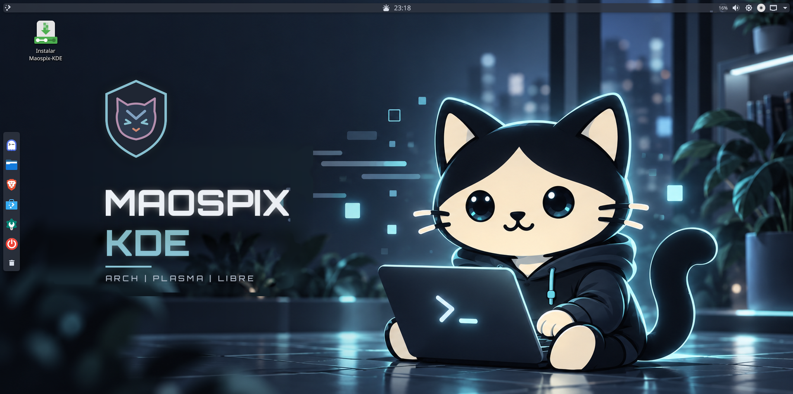
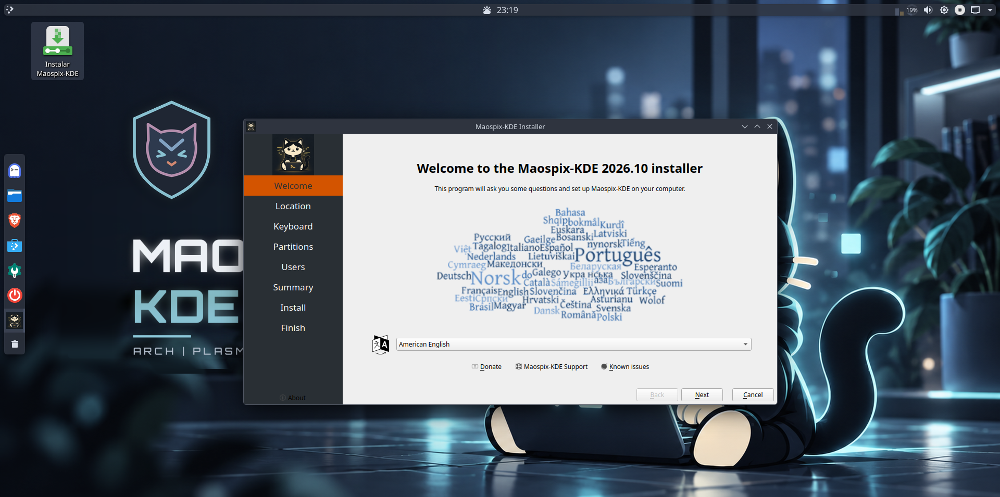

# Maospix-KDE

Distro propia basada en **Arch Linux + KDE Plasma**, con instalador gráfico (Calamares), tema oscuro Nord y todo preinstalado. Parte de la familia maospix, creada por Marcos Olmedo (maospy), Itauguá, Paraguay.



## Qué incluye

- **KDE Plasma** (Wayland) con tema propio: barra superior flotante y dock vertical a la izquierda.
- **Instalador Calamares** en español, con Btrfs por defecto.
- **Btrfs con snapshots automáticos:** snapper + snap-pac (snapshot antes y después de cada actualización) y grub-btrfs (arrancar desde un snapshot desde el menú de GRUB).
- **zram** como swap comprimida en RAM.
- **Ghostty** como terminal con **fish** como shell, y **fastfetch** con el logo del gatito. **yay** viene preinstalado para el AUR.
- **Brave** como navegador, **Discover** con **Flatpak/Flathub** como tienda.
- **Maospix Hello:** bienvenida en el primer inicio (actualizar, tienda, instalar NVIDIA, configuración).
- Wallpapers propios y SDDM tematizado.

## Instalar

1. Descargá la ISO desde la sección *Releases*.
2. Grabala en un pendrive (Ventoy, `dd` o Balena Etcher) o usala en una VM con **EFI activado**.
3. Arrancá el live y abrí "Instalar Maospix-KDE".



Requisitos: PC con UEFI, 4 GB de RAM o más y 30 GB de disco.

En VirtualBox: Linux / Arch Linux 64-bit, EFI activado, video 128 MB, controlador gráfico **VMSVGA**, sin aceleración 3D. Con menos memoria de video el escritorio se congela. El portapapeles compartido no funciona porque Plasma 6.8 es solo Wayland.

Ghostty necesita OpenGL 4.3: en VirtualBox no está disponible, y Maospix usa renderizado por software y, si falla, Konsole.

## Construir la ISO

Requiere un Arch Linux con `archiso` instalado.

```
git clone https://github.com/maospy/Maospix-KDE
cd Maospix-KDE
```

Los paquetes de AUR (calamares, brave-bin, cliamp-bin) se construyen con `makepkg` a partir de los PKGBUILD de `pkgbuilds/` y se dejan en `repo/` (repositorio `[maospix-local]`). Después:

```
sudo mkarchiso -v -w ~/archiso-work -o out archiso
```

Se recomienda correrlo dentro de `tmux`. En un equipo con HDD y 2 núcleos tarda bastante por la compresión xz.

## Estructura

- `archiso/`: perfil archiso (paquetes, permisos, airootfs con toda la configuración).
- `archiso/airootfs/etc/calamares/`: configuración del instalador.
- `archiso/airootfs/usr/local/bin/`: scripts propios (postinstall, postboot, Hello, terminal, NVIDIA).
- `pkgbuilds/`: PKGBUILD de los paquetes de AUR.
- `docs/HISTORIA.md`: historia de construcción, problemas y soluciones.

## Notas

- NVIDIA no viene preinstalado (para no romper `nouveau` en tarjetas viejas). Usá el botón en Maospix Hello.
- `/boot` es la partición EFI (FAT32): GRUB no logró leer el kernel desde este Btrfs. Los snapshots no incluyen el kernel.
- Los wallpapers y la fuente Orbitron (licencia OFL) se generaron para este proyecto.

## Licencia

[GPL-3.0](LICENSE). El software incluido conserva sus licencias originales (por ejemplo, el tema Nordic GTK es GPL-3.0).
